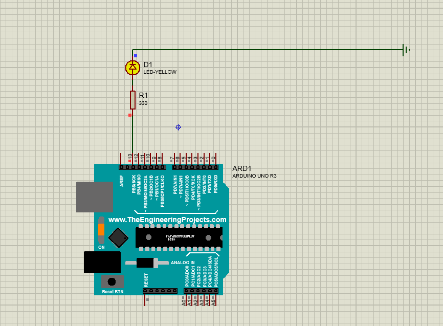
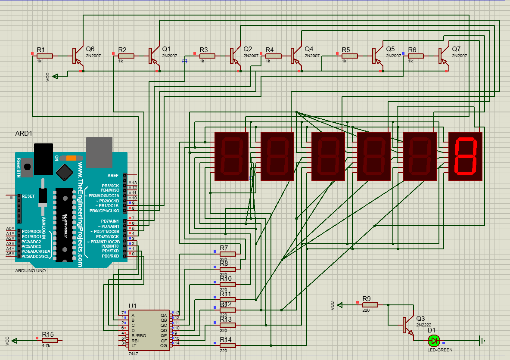
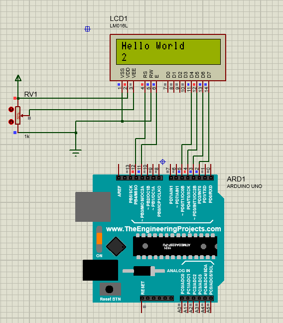
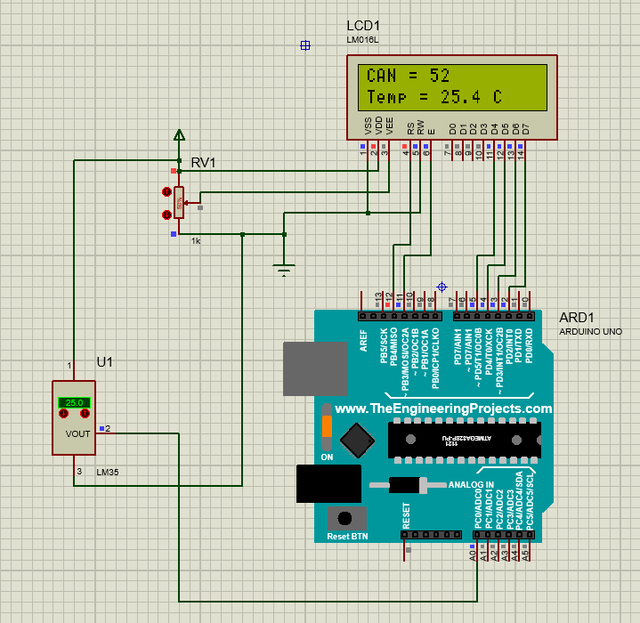
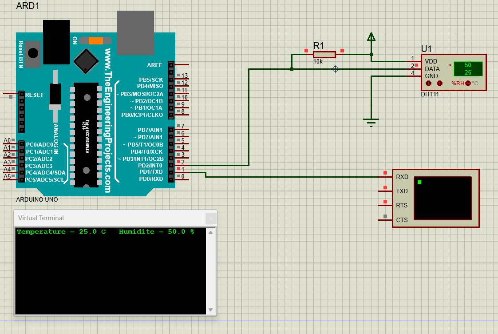

# Arduino UNO & Proteus — Embedded Systems Laboratory

A collection of academic embedded systems experiments developed using Arduino UNO, C/C++, and Proteus ISIS.

The laboratory covers digital I/O, non-blocking timing, push-button interfaces, traffic light control, seven-segment displays, LCD interfacing, analog temperature acquisition, alarm systems, and digital sensors.

## Technologies

- Microcontroller: Arduino UNO (ATmega328P)
- Programming: Embedded C/C++ (Arduino)
- Simulation: Proteus ISIS
- Development: Arduino IDE
- Version Control: Git & GitHub

## Laboratory Experiments

| Experiment | Description |
|---|---|
| LED Blink | Digital output and timing with delay() |
| Three LEDs | Synchronous blinking and timing variation |
| Push Buttons | Digital inputs and INPUT_PULLUP |
| Non-Blocking Timing | Independent LED blinking with millis() |
| LED Control Modes | Synchronous and sequential LED patterns |
| Traffic Lights | Two-way traffic light sequencing |
| Seven-Segment Displays | Numeric display and counting |
| Display Multiplexing | Multi-digit display control |
| Digital Clock | HH:MM:SS with 7447 decoder |
| LCD 16x2 | Text and elapsed-time display |
| LM35 Temperature Sensor | Analog acquisition and ADC conversion |
| Temperature Alarm | Threshold monitoring with LCD and buzzer |
| DHT11 Sensor | Temperature and humidity via serial communication |

## Repository Structure

- `arduino/` — Arduino source code (.ino)
- `proteus/` — Proteus simulation projects (.pdsprj)
- `firmware/` — Compiled Arduino UNO firmware (.hex)
- `screenshots/` — Simulation captures and observations
- `docs/` — Laboratory documentation

## Selected Simulation Results

### LED Control

### Digital Clock

### LCD Display

### LM35 Temperature Measurement

### DHT11 Sensor

## Technical Concepts

### Non-Blocking Programming

The `millis()` function is used to schedule independent operations without blocking the main execution loop.

### Analog-to-Digital Conversion

The LM35 produces an analog voltage proportional to temperature:

- Sensor sensitivity: 10 mV/degree Celsius
- ADC resolution: 10 bits
- Reference voltage: 5 V

Temperature is estimated using:

`Temperature (C) = ADC_Value * 500.0 / 1024.0`

### Display Multiplexing

Multiple seven-segment displays are controlled using time-multiplexed digit selection.

The digital clock uses a BCD-to-seven-segment decoder (7447) and transistor-based digit selection.

### Sensor Interfacing

- LM35: Analog temperature measurement
- DHT11: Digital temperature and humidity measurement
- LCD 16x2: Local information display
- Virtual Terminal: Serial communication monitoring

## Building and Running

1. Install Arduino IDE and Proteus with Arduino UNO simulation support.
2. Open the desired `.ino` sketch from the `arduino/` directory.
3. Select Arduino UNO as the target board.
4. Compile using the Arduino IDE.
5. Open the corresponding Proteus project.
6. Assign the appropriate `.hex` file to the Arduino UNO Program File property.
7. Run the simulation and observe the results.

The DHT11 sketch requires the Adafruit DHT sensor library and its dependencies.

**Note:** Proteus firmware paths may need to be updated for each computer. Circuit-to-firmware associations should be checked before running a simulation.

## Verification Status

- Five key Arduino sketches successfully compiled for Arduino UNO.
- LM35 temperature alarm tested in Proteus.
- HH:MM:SS clock tested in Proteus.
- Additional experiment screenshots are available in `screenshots/`.
- Full cross-machine reproduction of all Proteus projects is not yet verified.

## Learning Outcomes

This laboratory provides practical experience in:

- Microcontroller GPIO configuration
- Blocking and non-blocking timing
- Digital input processing
- Display interfacing and multiplexing
- Analog signal acquisition
- Threshold-based alarm control
- Digital sensor communication
- Embedded system simulation and debugging

## Project Context

Academic practical work in Real-Time and Embedded Systems.

The repository documents laboratory implementations and simulation results for educational and technical portfolio purposes.

## Project Team

This academic laboratory project was carried out by:

- **Bilal Bennasser**
- **Hajar Guadouli**
- **Fatima-Zahra Ibnesellaou**

## Laboratory Report

The complete group laboratory report includes circuit simulations,
experimental results, screenshots, and technical analysis.

[View the TP01 Laboratory Report (PDF)](docs/TP01_Bennasser-Bilal_Guadouli-Hajar_Ibnesellaou-Fatima-zahra.pdf)
